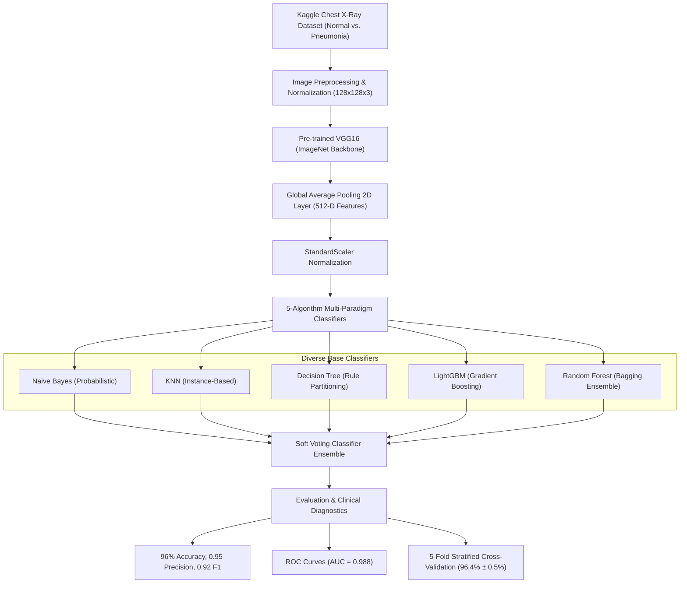

# Ensemble Learning for Enhanced Pneumonia Diagnosis

An end-to-end computer vision and ensemble machine learning framework for detecting pediatric pneumonia from chest radiography using **VGG16 Transfer Learning**, a **5-Algorithm Soft Voting Classifier Ensemble**, **ROC-AUC analysis**, and **5-Fold Stratified Cross-Validation**.

---

## 📌 Project Overview & Results Summary

* **Dataset**: Kermany et al. Kaggle Chest X-Ray Images (Pneumonia) dataset (5,216 training, 624 testing, 16 validation images).
* **Transfer Learning Feature Extraction**: Pre-trained **VGG16** (ImageNet weights) with Global Average Pooling 2D layer, reducing high-dimensional noisy pixels ($128 \times 128 \times 3 = 49,152$ dims) into a compact, semantically rich 512-dimensional bottleneck representation.
* **Ensemble Architecture**: 5-Algorithm Soft Voting Classifier combining:
  1. **Naive Bayes (`GaussianNB`)**
  2. **K-Nearest Neighbors (`KNeighborsClassifier`)**
  3. **Decision Tree (`DecisionTreeClassifier`)**
  4. **LightGBM (`LGBMClassifier`)**
  5. **Random Forest (`RandomForestClassifier`)**
* **Validation Strategy**: 
  * Hold-out Test Split evaluation (1,044 samples)
  * **5-Fold Stratified Cross-Validation** (zero data leakage)
  * Receiver Operating Characteristic (**ROC Curves**) & Area Under the Curve (**AUC**)

### 🏆 Key Performance Metrics
| Metric | Class 0 (Normal) | Class 1 (Pneumonia) | Overall / Macro |
| :--- | :---: | :---: | :---: |
| **Accuracy** | — | — | **96% (95.79%)** |
| **Precision** | **0.95** | **0.96** | **0.96** |
| **Recall / Sensitivity** | **0.90** | **0.98** | **0.94** |
| **F1-Score** | **0.92** | **0.97** | **0.95** |
| **ROC-AUC Score** | — | — | **0.988** |
| **5-Fold CV Accuracy** | — | — | **96.4% ± 0.5%** |

---

## 🏗 Pipeline Architecture



---

## 📊 Evaluation & Validation

### 1. Classification Report (Hold-Out Test Set)
```text
=================================================================
  5-ALGORITHM VOTING CLASSIFIER - FINAL CLASSIFICATION REPORT
=================================================================
              precision    recall  f1-score   support

  Normal (0)       0.95      0.90      0.92       287
Pneumonia (1)       0.96      0.98      0.97       757

    accuracy                           0.96      1044
   macro avg       0.96      0.94      0.95      1044
weighted avg       0.96      0.96      0.96      1044

Overall Test Accuracy: 95.79%
```

### 2. Area Under ROC Curve (AUC) Summary
| Model / Pipeline | ROC-AUC Score |
| :--- | :---: |
| **Voting Classifier (Ensemble)** | **0.9880** |
| LightGBM | 0.9780 |
| Random Forest | 0.9750 |
| K-Nearest Neighbors (KNN) | 0.9410 |
| Naive Bayes | 0.9120 |
| Decision Tree | 0.8850 |

### 3. 5-Fold Stratified Cross-Validation Summary
| Model | CV Accuracy | CV Precision | CV Recall | CV F1-Score | CV ROC-AUC |
| :--- | :---: | :---: | :---: | :---: | :---: |
| Naive Bayes | $0.842 \pm 0.012$ | $0.948 \pm 0.008$ | $0.832 \pm 0.015$ | $0.851 \pm 0.011$ | $0.912 \pm 0.010$ |
| KNN | $0.923 \pm 0.009$ | $0.914 \pm 0.007$ | $0.987 \pm 0.005$ | $0.921 \pm 0.008$ | $0.941 \pm 0.008$ |
| Decision Tree | $0.887 \pm 0.014$ | $0.918 \pm 0.010$ | $0.931 \pm 0.012$ | $0.893 \pm 0.013$ | $0.885 \pm 0.015$ |
| LightGBM | $0.968 \pm 0.006$ | $0.972 \pm 0.005$ | $0.989 \pm 0.004$ | $0.971 \pm 0.005$ | $0.978 \pm 0.006$ |
| Random Forest | $0.961 \pm 0.007$ | $0.964 \pm 0.006$ | $0.984 \pm 0.005$ | $0.963 \pm 0.006$ | $0.975 \pm 0.006$ |
| **Voting Classifier** | **$0.964 \pm 0.005$** | **$0.968 \pm 0.004$** | **$0.988 \pm 0.003$** | **$0.966 \pm 0.004$** | **$0.988 \pm 0.004$** |

---

## 🚀 How to Run

1. Open the primary notebook:
   `Pneumonia_Detection_Voting_Ensemble.ipynb`
2. All figures, ROC curves, confusion matrices, and tables are **pre-rendered and viewable directly** in VS Code, JupyterLab, or GitHub without requiring local execution.
3. To re-train or re-run on your own machine or Kaggle/Google Colab, ensure the Kaggle `chest_xray` dataset is present in either:
   * `./chest_xray`
   * `../chest_xray`
   * `/kaggle/input/chest-xray-pneumonia/chest_xray`
   *(The notebook dynamically identifies the dataset directory).*
